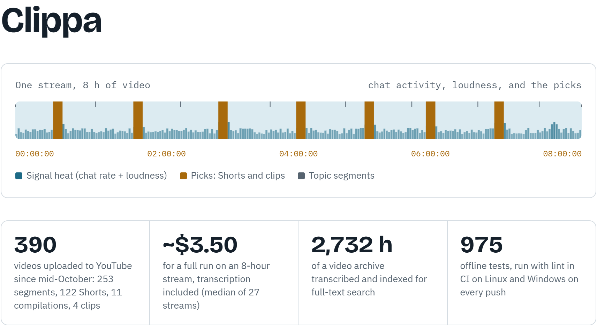

<p align="center">
  <a href="https://byvfx.github.io/clippa/">
    <picture>
      <source media="(prefers-color-scheme: dark)" srcset="docs/readme/hero-dark.png">
      
    </picture>
  </a>
</p>

[](https://github.com/byvfx/clippa/actions/workflows/check.yml)

[](https://ko-fi.com/byvfx)

**Clippa** turns long Kick streams into YouTube uploads: full-length segments, topic compilations,
Shorts, titles, descriptions, chapters and thumbnails, with a human review step before
anything goes out. The app was called clipper, and the rename is under way (#286): the command
and package are `clippa` now (`clipper` still works), while the config files (`clipper.toml`),
`CLIPPER_*` settings and containers keep the old name until the rename's deploy step.

**[How it works, what it costs and why it's built this way](https://byvfx.github.io/clippa/)**:
the full breakdown (the figures above are as of 14 November 2026).

```
fetch / record -> signals -> transcribe -> score -> segments -> faces -> cut -> meta -> thumbs -> shorts
                                                                                    |
                        upload <- schedule <- review (Kitsu, Discord, war room) <- review publish
```

**The docs are at [byvfx.github.io/clippa-docs](https://byvfx.github.io/clippa-docs/)**,
built from [docs/wiki/](docs/wiki/) (`mkdocs build --strict`). The
[wiki](https://github.com/byvfx/clippa/wiki) mirrors the same pages. New here:
[Getting started](https://byvfx.github.io/clippa-docs/getting-started/).

## Quick start

From the clipper folder on a new machine (keep the folder path short on Windows, e.g. `C:\clipper`):

```powershell
powershell -ExecutionPolicy Bypass -File deploy\bootstrap.ps1   # macOS/Linux: bash deploy/bootstrap.sh
```

It installs uv, Python 3.12 and ffmpeg if they're missing, puts a `clippa` command on PATH,
then runs `clippa setup` and `clippa doctor`. Then, in a new terminal:

```bash
clippa fetch <kick vod url>
clippa run <stream id>
```

`clippa -h` lists the commands by group; `clippa <command> -h` gives each one's flags.

## In the repo

- `clippa/`: the package, one module per stage; `clippa/cli.py` wires them
- `docs/wiki/`: the wiki's pages (edit them here, in the same PR as the code)
- `clippa/defaults.toml`: every setting with its default, documented; `clipper.example.toml` is a starter clipper.toml
- `HANDOFF.md`: current state between work sessions; `docs/log/` has the dated diary
- `AGENTS.md`: rules for code sessions
- `studio/`: the studio's working files (mockups, research notes, media-heavy reports); not part of the package
- `brand/`: the mark, lockups and app icon ([BRAND.md](brand/BRAND.md))
- `LICENSE`: MIT
