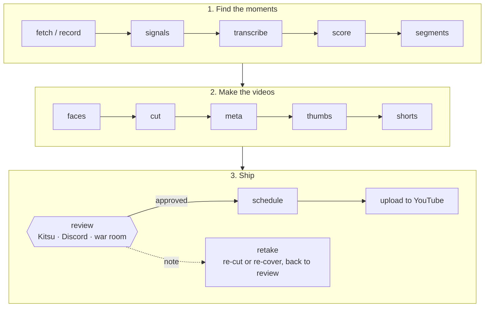

One stream in, a reviewed set of videos out:



Everything is a `clippa <stage>` subcommand working on one stream's folder, `streams/<id>/`.
Stages are idempotent: `clippa run <id>` does every stage the stream still needs, and
`clippa run <id> --from cut` runs from a stage on again (`clippa run -h` lists the stages). Four
of them are the fast lane's early versions for the picks, what the Shorts need first: `clips`,
`clips_meta`, `clips_thumbs` and `clips_review` are `cut`, `meta`, `thumbs` and `review
publish` run on the picks alone, before the slow stages do the segments and compilations.
`--only` and `--from` choose stages, not what they redo: each keeps the paid work it finds
(drafts, covers, unchanged cuts), so to redo a cover or a draft run the stage itself,
`clippa thumbs <id> --items s03 --force` or `clippa meta <id>`.

## Stages

- **fetch / record**: a finished Kick, Twitch or YouTube VOD ([Fetching VODs](Fetching-VODs)), or a Kick stream as it happens ([NAS recorder](NAS-recorder)), with chat.
- **signals**: chat activity and loudness into a heat curve (the war room [draws it](War-room#heat)).
- **transcribe**: WhisperX (NVIDIA, or on [Modal](Transcribe-on-Modal)'s cloud GPUs) or
  mlx-whisper (Apple Silicon) to word timestamps; with `[transcribe] diarize`, speaker turns
  too, named per show by `clippa speakers` ([Speakers](Speakers)). Once a stream has names,
  the transcript the model stages read tags each turn (`[PPP] ...`, `[?]` for a voice nobody
  named, `[music]`), and the weekly credits a quote to whoever said it.
- **score**: Claude reads the transcript and heat curve and proposes moments and picks. A
  rerun pays every window again, so it refuses without `--force`.
- **segments**: Claude splits the stream into topic segments and compilations. With
  `[segments] score = true` (off by default) one more call scores each cut segment 1-10 as its
  own upload, from the segment and the show's record per topic; see
  [Segment scores](Pipeline#segment-scores).
- **faces**: who is on screen, by face, over every keyframe (CPU, `clippa faces`): groups named
  against known faces kept for every show ([Faces](Faces)). The worker runs it after the fast
  lane, before the slow cut.
- **cut**: lossless segment cuts on keyframes, re-encoded picks, bleeps; a few segments at once,
  on the NAS beside the source with `[cut] backend = "nas"` ([NAS recorder](NAS-recorder)).
- **meta**: titles, descriptions, tags, chapters and SRT captions.
- **thumbs**: tabloid-style [covers](Covers) (a 9:16 one for each Short), with photos from the
  [cast library](Cast-library) for people talked about but not on screen.
- **shorts**: vertical captioned Shorts. With `[shorts] window = "short"` each Short is the
  pick's scored hot-take moment (15-59 s here, under YouTube's 60 s Content ID block line),
  ending on a full sentence. Picks are also cut as horizontal clips; leave `"picks"` out of
  `[review] include` to post only their Shorts. Each show's screen layouts are measured once
  ([Adding a show](Adding-a-show)). With `[edit] tighten` on, the dead air goes too
  ([Tightening](#tightening)).
- **review**: every item goes to Kitsu and Discord. Approve, reject, hold, or leave a note
  asking for a change. Notes become retakes: the item is re-cut or re-thumbnailed and comes
  back for review ([Review](Review), [War room](War-room)).
- **schedule / upload**: approved items get release slots and go to YouTube as private videos
  with a publish time ([Scheduling and uploads](Scheduling-and-uploads)).

Elsewhere after review: [X posts](X-posts), [TikTok](TikTok) (by hand), and `clippa rumble`,
which prepares folders for Rumble's upload form.

## Tightening

`[edit] tighten = true` (per show: `[shows.<key>.edit]`; off by default) cuts the dead air out of
each Short as `clippa shorts` renders it. A pause between two words longer than `max_gap_s`
(0.7 s) is cut down to `keep_gap_s` (0.25 s), or `keep_turn_s` (0.45 s) where the voice changes so
a reply keeps its beat. It only cuts where the audio is quiet too (under `silence_db`, -35 dB):
a laugh, a video playing or a reaction in a gap stays. No cut is under `min_cut_s`, none reaches
into a word or a bleep, and a Short never drops under `[shorts] min_s`. Captions and scene
changes move with the cuts.

The Kitsu "Tightened" column says what went ("3 pauses, 1.6 s"); the Short's sidecar lists each
cut with the words either side, and a retake is told where they were so a note's times still
land. To put one Short's pauses back:
`clippa shorts <stream> --items v03 --no-tighten` (`--tighten` undoes it), then
`clippa review publish <stream> --only shorts`. Tried on the test stream on 2026-11-09: about
1.5 s out of a 30-40 s Short at these settings.

## Shorts from a stretch you name

`clippa pick` is for when you watched the show and know where the good bits are:
`clippa pick <stream> --from 4:05:00 --to 4:25:00 --about "the Quartering bit"` (or
`--at 4:50:00`, or only `--about`, which searches the stream's summary first; `--find <word>`
lists transcript lines for free). Times are the Kick VOD's clock. The moments found join the
stream's picks (ids `h01`...) and go through cut, meta, thumbs, Shorts and review like scored
ones; `--dry-run` shows them without saving.

## The worker

`clippa worker` runs the pipeline for each recording as it finishes. Clips and Shorts come
first (`[worker] fast_lane`): once a stream is transcribed and scored, its picks and their
Shorts are cut, written up and sent to review (roughly an hour after an 8-hour show ends), and
only then does the worker cut the long segments and compilations, which take hours. A newer
stream's clips go ahead of an older stream's segments. `clippa worker --status` shows each
recording's stages.

## What reruns cost

> [!WARNING]
> Model calls cost money. Check what a rerun of `score`, `segments`, `meta` or `thumbs` costs
> on a long stream first ([Costs](Costs)).

`score` refuses a rerun without `--force` (`clippa run --from` passes it), `cut` keeps picks
whose in/out points are unchanged, `thumbs` keeps a cover whose cut is unchanged, and
`weekly --render` never drafts.

[Pre-shows](Pre-shows) and one-off YouTube videos take a shorter path: one whole video, no
clips or Shorts.

## Segment scores

Which of a stream's segments go out is decided by its budget, and the budget ranks segments by
chat heat, which barely tracks views ([what predicts views](Scheduling-and-uploads#what-predicts-views)).
A segment score is a model's guess instead (`clippa/segscore.py`, prompt `segment_score_v1`):
one call per stream sees every cut segment (title, summary, topic, kind, how much is someone
else's video) and the show's track record, the median and best 7-day views of its earlier
uploads on each topic, and scores each 1-10 against the show's typical upload, with one
sentence of why.

```bash
clippa segments <stream> --score --dry-run     # what it costs (a few cents on summaries)
clippa segments <stream> --score               # into segments.json: score, score_why
clippa segments --backtest --dry-run           # every past stream, as of its start
clippa segments --backtest [--transcript]      # -> segment_scores_backtest.json per stream
clippa analytics --lift --kind segment         # the bt / bt_tx rows: did it rank them right?
```

`[segments] score = true` scores each new stream after its split; `score_transcript` sends each
segment's transcript too (~100k tokens for an 8 h stream, about $0.40 on Opus). The backtest
scores past streams with the track record cut off at each stream's start, so nothing learned
later leaks in, and writes beside segments.json, never into it. A stream's own uploads are never
in its own record. Pre-shows and stories are one whole video and aren't scored. The model now
and then passes over a segment on a touchy subject: it is asked once more, and what it still
leaves out stays unscored.

The budget ranks a stream's segments by the score (#258 C): each segment's score plus half its
chat-heat percentile in the stream, so heat only breaks ties between equal scores, and a
segment the model passed over gets the stream's median. A stream without scores, or with a
segment cut after the score ran, is ranked by heat alone: one ranking never mixes the two. A
compilation takes its best segment's score. Kitsu's Score column on a segment shows it; editing
it there changes nothing (the score lives in segments.json). On this install `[segments] score`
is on since 2026-11-14 (the backtest: level with heat on Kino, clearly better on Channel 404).
